<a href="https://x.com/gathoni_zarah">X</a> &nbsp;·&nbsp;
<a href="https://www.linkedin.com/in/mary-wangui--/">LinkedIn</a> &nbsp;·&nbsp;
<a href="https://medium.com/@zarahgathoni76">Medium</a> &nbsp;·&nbsp;
<a href="mailto:zarahgathoni76@gmail.com">Email</a>

## About

I build on-chain products and help them land in African markets. Solidity, Rust and Motoko
on the contract side; React, Next.js and TypeScript on the front. Most weeks involve some of both
engineering and go-to-market: crop insurance that pays out to M-Pesa, payroll that streams by the
second, a prediction market built for this continent.

Based in Nairobi, Kenya. Open to freelance and contract work.

## Currently

- **Founder at [KoruFlux](https://koruflux.com/):** Web3 and fintech market entry into Africa, including Kenya's VASP framework
- **BD & Partnerships at [MicroCrop](https://www.microcrop.app/):** growing blockchain crop insurance across Kenya and beyond

## Selected work

| Project | What it does | Built with |
|:--|:--|:--|
| **[MicroCrop](https://www.microcrop.app/)** | Parametric crop insurance for smallholder farmers. WeatherXM data triggers payouts automatically, settled straight to M-Pesa. | React, Solidity, Node.js |
| **[Strimz](https://www.strimz.xyz/)** | Token streaming for salaries, subscriptions and utilities. Upload a CSV, set an interval, payments run on schedule. | Next.js, Solidity, TypeScript |
| **[builderUptime](https://projectone.app/)** | Farcaster-native time tracking. Smart accounts mean logging a session takes one tap. | Next.js, Smart Accounts, GraphQL |
| **[AntiKorrupt](https://px7id-byaaa-aaaak-albiq-cai.icp0.io/)** | An AI tutor trained on UN anti-corruption material, wrapped in a game. | Svelte, Motoko |
| **[P2P Farmers](https://pm4fe-4iaaa-aaaak-ao7bq-cai.icp0.io/)** | Farm-to-consumer marketplace. 3rd place, ICP Mega Hackathon. | React, Motoko |

## Stack

Solidity, Rust, C++, Motoko, Cairo, TypeScript, JavaScript, Foundry, Hardhat, Next.js, React, Node.js, PostgreSQL, GraphQL, Tailwind, Anchor

## Latest writing

<!-- BLOG-POST-LIST:START -->- [My first kill: Bitcoin Mutants](https://medium.com/@zarahgathoni76/my-first-kill-bitcoin-mutants-9e4e5a08a1a6?source=rss-13fd05408f56------2) Nov 2026
- [First time? Wallet Interaction from Bitcoin Core](https://medium.com/@zarahgathoni76/first-time-wallet-interaction-from-bitcoin-core-73c09e7bb8f8?source=rss-13fd05408f56------2) Oct 2026
- [Lightning Transaction Through the Codebase](https://medium.com/@zarahgathoni76/lightning-transaction-through-the-codebase-702b55b56703?source=rss-13fd05408f56------2) Oct 2026
- [An Overview of Bitcoin Scripts, Addresses, and Encodings](https://medium.com/@zarahgathoni76/an-overview-of-bitcoin-scripts-addresses-and-encodings-f97eea8db202?source=rss-13fd05408f56------2) Sep 2026
- [The WHY Behind Bitcoin’s Design](https://medium.com/@zarahgathoni76/the-why-behind-bitcoins-design-6b56eef7128d?source=rss-13fd05408f56------2) Aug 2026
<!-- BLOG-POST-LIST:END -->

## Work with me

Building something that needs to work in African markets?

**[zarahgathoni76@gmail.com](mailto:zarahgathoni76@gmail.com)** &nbsp;·&nbsp; **[koruflux.com](https://koruflux.com/)**

Most of what I ship is under contract and lives in private repos. The work above is the public trail.
